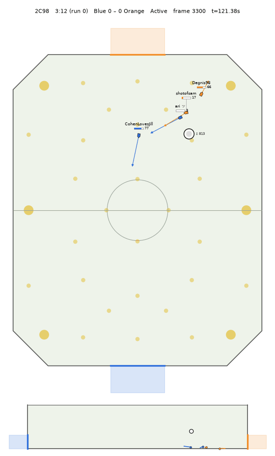
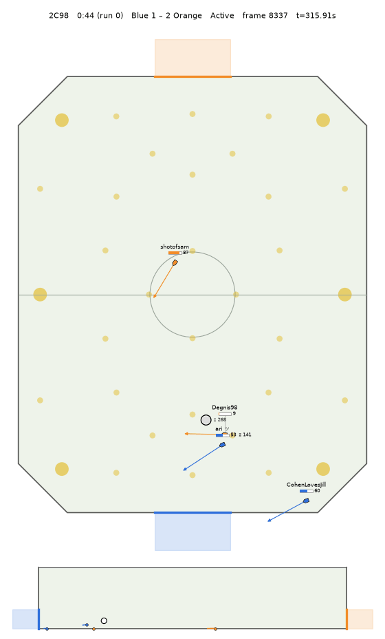
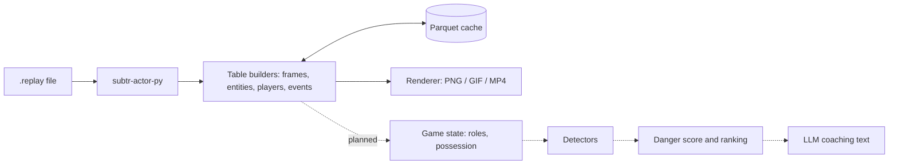
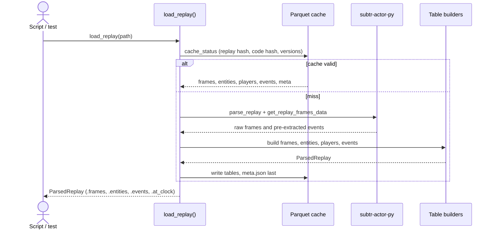

<div align="center">

# RL Decision Review

**A Rocket League replay analyzer that turns `.replay` files into clean frame and event tables, built toward ranking the decisions that cost a team the most.**


</div>




**Tech:** Python 3.12 · subtr-actor-py · pandas · NumPy · Parquet · matplotlib · pytest · uv

---

## Overview

Rocket League coaching mostly happens by rewatching video, and video is a poor input for finding mistakes: you can't query it, and judging who was at fault takes a human who already knows the game. But a `.replay` file is not video. It is the recorded game state (positions, velocities, boost, and touches at about 30 Hz), which means decisions like a double commit or a last-man challenge can be detected by deterministic code instead of guessed at by a model.

I'm building this solo, with my own judgment as a former Grand Champion in 2v2 as the ground truth for what counts as a mistake. The foundation is done: replays parse into normalized frame and event tables, cache to Parquet, and render as top-down snapshots and clips so every number can be checked against a moment I remember. The detectors, danger scoring, web app, and LLM coaching text come next, and an LLM will only ever write the final explanation from detector output.

## Features

**Replays become clean, queryable tables.** One call returns a per-frame table, a long-format table of the ball and every car (position, velocity, rotation, boost 0 to 100), a player table, and an events table with touches, goals, demos, kickoffs, boost pickups, and the game's own shot, save, and assist credits.

**Touches carry a confidence level instead of a guess.** The game's stats stream and a physics check on the ball's velocity change are combined, and a 50/50 between two cars is flagged as contested (against an opponent or a teammate) instead of being awarded to whoever is closer by a few units.

**A second load takes about 30 ms.** Parsed tables are cached as Parquet and invalidate themselves when the replay, the parsing code, or the parser version changes.

**Any moment can be checked by eye.** A top-down renderer draws the field, cars at true hitbox size, boost bars, velocity arrows, touches, and demos, plus a side-view inset. It saves PNG snapshots or GIF and MP4 clips of any in-game clock time.

## Results

- Goals, scorers, and demos match the scoreboard and my own notes on both test replays (10 of 10 goals, 10 of 10 scorers)
- The touch rule credits the right player on 29 of 30 shots and saves; the stats stream and physics agree on 82% to 96% of touches
- A cold parse takes about 2 to 3 seconds per replay; a cached load reads the tables in about 30 ms
- 190 tests (synthetic unit tests plus tests against real replays), with lint and format checks passing
- Verified so far on 2 ranked 2v2 replays; broader coverage and an overtime replay are the next robustness step

## Tech Stack

| Layer | Technology | Notes |
| ----- | ---------- | ----- |
| Language / tooling | [Python 3.12](https://www.python.org/) + [uv](https://docs.astral.sh/uv/) | `src/` layout, locked dependencies in `uv.lock`. |
| Replay parsing | [subtr-actor-py](https://pypi.org/project/subtr-actor-py/) | Built on the boxcars replay parser; used at its native frame rate. |
| Data | [pandas](https://pandas.pydata.org/) + [NumPy](https://numpy.org/) | Nullable and categorical dtypes for NA-safe tables. |
| Cache | [Apache Parquet](https://parquet.apache.org/) via [PyArrow](https://arrow.apache.org/docs/python/) | Round-trips every dtype exactly. |
| Visualization | [matplotlib](https://matplotlib.org/) | Top-down snapshots and GIF clips; MP4 when ffmpeg is installed. |
| Tests / lint | [pytest](https://pytest.org/) + [Ruff](https://docs.astral.sh/ruff/) | Replay tests skip when the gitignored replays are absent. |

## Screenshots

**Clip into 0:44:** top-down view with boost, velocity, trails, and the side-view inset


## Architecture



Solid arrows exist today. The dashed ones are the planned pipeline, and the rule behind it is that detectors must be right before any AI explains them.

## Engineering Decisions

**Building on raw network frames instead of the resampled array.** The parser offers a convenient numeric array, so it was the obvious starting point. Looking closer, it defaults to 10 fps, copies the next raw frame instead of interpolating, and fills the gaps left by unrecorded goal replays with invented rows. I built the frame table from `get_replay_frames_data` at the native rate (about 30 Hz), which keeps real timestamps and shares one `frame` index with every event. Goal-replay gaps simply have no rows, and the frames on either side are flagged as not live.

**Combining two touch sources and flagging 50/50s instead of picking a winner.** The library's `touch_events` has no player and mostly signals that the hitting team changed, so it misses goal shots. Its stats stream has players but disagrees with the physics (ball velocity change near a car) on a meaningful share of touches, and distance can't settle a 50/50: on one replay, two cars were 176 and 178 units from the ball. The rule in `rldr.parse.touches` uses the stats stream as the base, physics for timing, and marks contested touches with the second player and a contest type. Physics-only additions need strict conditions, so they add just one touch in each replay. Wrong blame is worse than no blame, and a teammate contest is exactly the signal the double-commit detector needs.

**Treating a demolished car as absent, not frozen.** After a demo, the recorded car stays in place for about 3 seconds with its boost draining, and goal resets add `Empty` frames. A detector that trusted those positions would see a car standing still in the middle of the field. The entity table sets `is_demolished` from the demo event until respawn and nulls position, velocity, rotation, and boost for that window, and `is_present` marks the empty frames separately. "Is this car actually on the field" becomes one condition: `is_present & ~is_demolished`.

**Invalidating the cache on a hash of the parsing code.** A stale cache would silently corrupt every detector built on top of it, and a version number only helps if someone remembers to bump it. The cache is valid only if the replay's sha256, `CACHE_VERSION`, the parser version, and a sha256 over every `.py` file in `rldr/parse/` all match, so any edit to parsing logic forces a re-parse with no bump. `meta.json` is written last through a temp file, so an interrupted write reads as "no cache" instead of a half-valid one.

**Checking the renderer against a moment I remembered.** The first renders drew the field mirrored, and the tests passed anyway. I caught it by comparing the 0:38 play to my memory: it was on the left side and the picture showed it on the right. Rocket League uses Unreal's left-handed axes, so from Blue's end, +x is on the left. The top view now draws +x on the screen's left, the `roll` sign was corrected for the same reason, and `CACHE_VERSION` was bumped. This is why every task in the roadmap ends with a visual check against a replay moment I can vouch for.

## What's Next

- Finish the robustness pass (1.6). The overtime logic reads the game's own flag but is untested, because neither test replay went to overtime.
- Add game state (phase 2): goal-side, time to ball, rotation roles, and possession, including deciding who actually won each flagged 50/50.
- Build the detectors (phase 3) against a set of private lab replays where I deliberately play each mistake, with ground-truth labels and an evaluation harness. Double commit comes first, then last-man challenge, boost starve, rotation cut, and overcommit.
- Rank flags by decision cost with a danger score (phase 4), then add the analysis API, a web report with shareable links, and LLM-written coaching text (phases 5 and 6).

<details>
<summary><b>Technical deep dive</b></summary>

**Core mechanic:** A replay is parsed once into four normalized tables sharing one `frame` index, cached to Parquet, and read back by the renderer and (soon) the detectors.

### Load sequence



### Architecture notes

- **One frame index everywhere.** `frames`, `entities`, and `events` all key on the raw network frame number, so a detector can join them without remapping.
- **Clock handling is explicit.** `clock` follows the in-game clock, which freezes after a goal until the kickoff touch, so one clock second can contain two stretches of play. `at_clock` separates them with a `run` number.
- **Dead time is flagged.** Goal replays have no rows, and countdown and post-goal frames get `is_live = False`, so detectors can ignore them.
- **Boost is normalized at the door.** Raw boost is 0 to 255 and is converted to 0 to 100 in the entity table.
- **Players are keyed by platform and ID.** A key like `Steam:7656...` or `Epic:...` is stable where display names are not, and the replay's `OnlineID` field is unreliable on Epic.
- **Touch confidence has three levels.** High means the sources agree and the touch is uncontested, medium means one source or an opponent 50/50, and low means a teammate contest or a source conflict, so detectors can skip or soften blame.
- **Rotation conventions are verified, not assumed.** Yaw, pitch, and roll signs were checked on wall-driving frames against the quaternion axes, and pitch above zero means nose up.
- **Configuration will live in one place.** Detector thresholds are planned for a single mode-aware config (2s and 3s have different norms), not scattered through code.

### Project structure

```text
rl-decision-review/
├── src/rldr/
│   ├── parse/           # frames, events, touches, Parquet cache
│   ├── viz/             # field geometry, scene rendering, clips
│   ├── state/           # (planned) field geometry, roles, possession
│   ├── detectors/       # (planned) one module per detector
│   ├── danger/          # (planned) danger score
│   └── report/          # (planned) ranked report
├── scripts/             # parse, frames, events, touches, render, explore CLIs
├── tests/               # unit tests plus replay tests (skipped without replays)
├── labels/              # ground-truth labels for lab replays (planned)
├── replays/             # .replay files (gitignored) + NOTES.md
├── docs/                # demo clips used in this README
├── ROADMAP.md           # phase checklist with notes and a decision log
└── CLAUDE.md            # project context and Rocket League domain notes
```

`ROADMAP.md` records every finding and decision as the work happens, and `replays/NOTES.md` holds the remembered moments each replay is checked against.

</details>

<details>
<summary><b>Run it locally</b></summary>

### Prerequisites

- [uv](https://docs.astral.sh/uv/) (it installs Python 3.12 for you)
- Your own `.replay` files in `replays/` for anything beyond the unit tests (replays are gitignored)
- (Optional) ffmpeg, only for MP4 clips

### Setup

```bash
git clone https://github.com/ar1shah/rl-decision-review.git
cd rl-decision-review
uv sync
uv run pytest        # replay tests skip when no replays are present
```

### Useful scripts

| Script | Command |
| ------ | ------- |
| Tests | `uv run pytest` |
| Lint / format | `uv run ruff check .` / `uv run ruff format .` |
| Inspect raw parser output | `uv run python scripts/explore.py [replays/<file>.replay]` |
| Ball and car state at a clock time | `uv run python scripts/frames.py replays/<file>.replay --clock 3:06` |
| Events near a clock time | `uv run python scripts/events.py replays/<file>.replay --clock 3:47 --type touch` |
| Build or refresh the Parquet cache | `uv run python scripts/parse.py [replays/<file>.replay] [--force]` |
| PNG snapshot | `uv run python scripts/render.py replays/<file>.replay --clock 3:06` |
| GIF clip | `uv run python scripts/render.py replays/<file>.replay --clock 3:06 --seconds 6` |

</details>

---

RL Decision Review is a personal project in active development, so there is no live app yet. The test replays are not in the repo, so the demo clips above and `ROADMAP.md` are the best look at it.

Ari Shah · [Portfolio](https://www.ar13.dev/) · [LinkedIn](https://linkedin.com/in/arishah)
